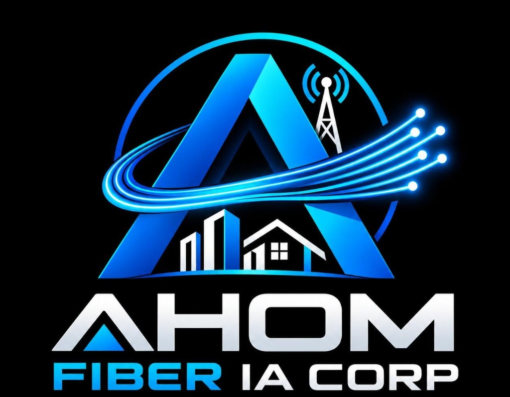

# 🌐 AHOM FIBER IA CORP — Constelación Neuronal 3D del Portafolio Corporativo

<p align="center">
  
</p>

Plataforma corporativa de visualización tridimensional e inteligencia artificial conversacional para la infraestructura, servicios y gobernanza de **AHOM FIBER IA CORP (Empresa de Telecomunicaciones y Conectividad Digital)**.

---

## 🚀 Características Principales

- **Constelación 3D Interactiva (Three.js):** 50 nodos corporativos organizados en 8 departamentos estratégicos (Fibra Óptica DWDM, Data Centers Tier III, Soluciones B2B, Soporte N1/N2, etc.).
- **Diseño 100% Responsivo y Multi-Dispositivo:** Optimizado para smartphones, tablets y pantallas de escritorio con gestos táctiles (zoom por pellizco, rotación 360°, paneo) y panel deslizante nativo para móviles.
- **Red de Agentes IA Especializados:** Asistentes departamentales para resolver consultas técnicas, comerciales, financieras y jurídicas, con transiciones cinemáticas 3D inter-departamentales.
- **Cierres Conversacionales Inteligentes:** Detección de intenciones de despedida/cierre (*"no tengo más consultas"*, *"no gracias"*, etc.) y botón directo de acción rápida `🛑 Finalizar Chat`.
- **AHOM Voice IA:** Widget esférico cuántico con reconocimiento de voz y síntesis auditiva en tiempo real.

---

## 📱 Despliegue y Acceso Multi-Plataforma

### 1. Despliegue en GitHub Pages (Web Inmediata)
Este repositorio incluye un flujo de trabajo automatizado de **GitHub Actions** (`.github/workflows/deploy.yml`):
1. Ve a **Settings** > **Pages** en tu repositorio de GitHub.
2. En **Build and deployment > Source**, selecciona **GitHub Actions** (o **Deploy from a branch > master/main > / (root)**).
3. Tu aplicación quedará disponible en:
   ```
   https://<tu-usuario>.github.io/AHOM_FIBER_IA_CORP/
   ```

### 2. Despliegue en Vercel
El proyecto incluye configuración nativa en `vercel.json`:
1. Importa tu repositorio en [Vercel](https://vercel.com).
2. Deja los ajustes predeterminados (Static Project).
3. Despliega con 1 solo clic. También puedes usar Vercel CLI:
   ```bash
   vercel --prod
   ```

### 3. Conexión del Backend en la Nube (Render / Railway / Docker)
Para habilitar el motor completo de IA en la nube accesible desde cualquier celular o PC fuera de tu red:
- **Render.com:** Conecta este repositorio en Render como **Web Service** (detecta automáticamente `render.yaml` y `Procfile`). Te otorgará una URL pública con HTTPS gratuito (ej: `https://ahom-fiber-ia-corp.onrender.com`).
- En la interfaz web, presiona el botón **☁️ Nube** en la barra superior y escribe tu URL de Render para sincronizar tu teléfono con tu backend.

### 4. Ejecución en Red Local (Mismo Wi-Fi)
Para abrir la constelación desde tu celular o tablet conectado al mismo Wi-Fi de tu computador:
1. Averigua la IP local de tu computador (ejecuta `ipconfig` en Windows, ej: `192.168.1.50`).
2. Inicia el backend escuchando en todas las interfaces:
   ```bash
   uvicorn core_engine.main:app --host 0.0.0.0 --port 8000
   ```
3. Desde el navegador de tu celular (Safari o Chrome), ingresa a:
   ```
   http://192.168.1.50:8000
   ```
   *(El servidor FastAPI sirve la aplicación 3D completa directamente en el puerto 8000).*

---

## 💻 Instalación Local

```bash
# 1. Clonar el repositorio
git clone https://github.com/Johandres90/ETB_Neural_Constellation.git
cd ETB_Neural_Constellation

# 2. Crear y activar entorno virtual
python -m venv venv
venv\Scripts\activate   # En Windows
source venv/bin/activate # En Linux/Mac

# 3. Instalar dependencias
pip install -r requirements.txt

# 4. Iniciar el servidor
python -m uvicorn core_engine.main:app --reload --host 0.0.0.0 --port 8000
```

Abre en tu navegador: [http://localhost:8000](http://localhost:8000).

---

## 📂 Estructura del Proyecto

```
AHOM_FIBER_IA_CORP/
├── assets/                     # Recursos visuales y logotipo oficial
│   └── logo.jpg                # Logotipo oficial AHOM FIBER IA CORP
├── core_engine/                # Backend FastAPI & Lógica de Agentes
│   ├── main.py                 # Endpoints REST y servidor de archivos estáticos
│   ├── agent_manager.py        # Orquestador jerárquico de IA y RAG
│   └── prompts.py              # Definición de agentes y directrices
├── frontend/                   # Interfaz de Usuario Three.js & Chat
│   ├── assets/logo.jpg         # Logotipo frontend
│   └── index.html              # Aplicación Web 3D interactiva y responsiva
├── knowledge_base/             # Bases de conocimiento modulares por departamento
├── .github/workflows/deploy.yml# CI/CD automatizado para GitHub Pages
├── Dockerfile                  # Contenedor para despliegues universales
├── Procfile                    # Comando de inicio para Railway/Render
├── render.yaml                 # Configuración de infraestructura Render
├── vercel.json                 # Configuración de despliegue para Vercel
├── requirements.txt            # Dependencias Python
└── index.html                  # Punto de entrada raíz para GitHub Pages y Vercel
```

---

## 📄 Licencia y Autoría
Desarrollado para el ecosistema corporativo e institucional de **AHOM FIBER IA CORP**.
